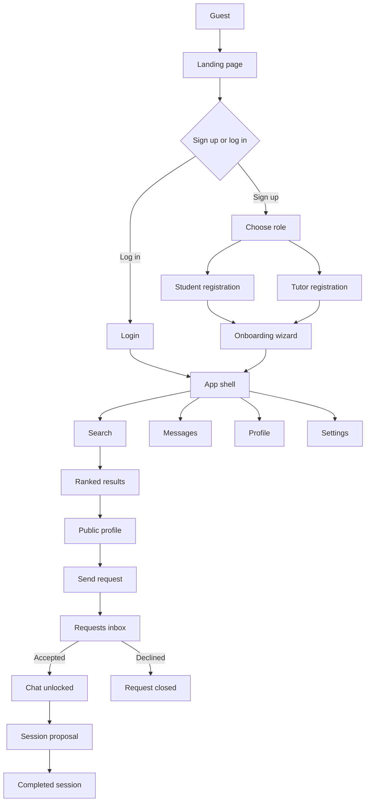
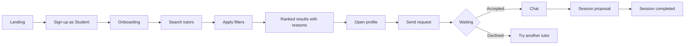
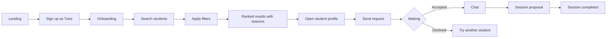
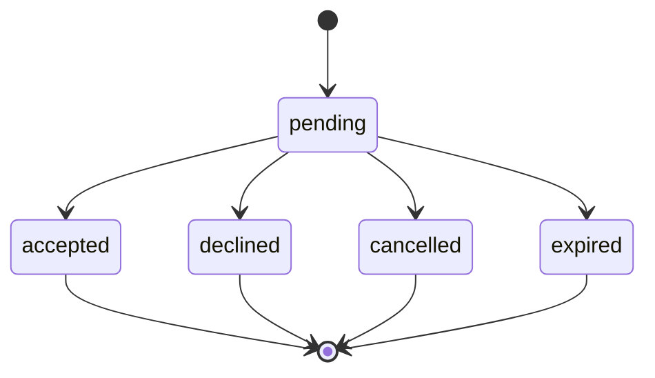
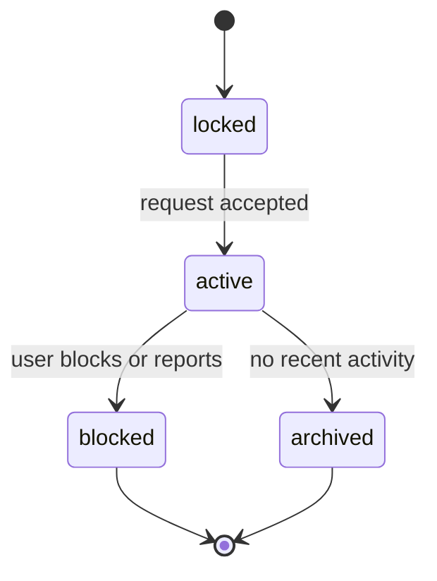
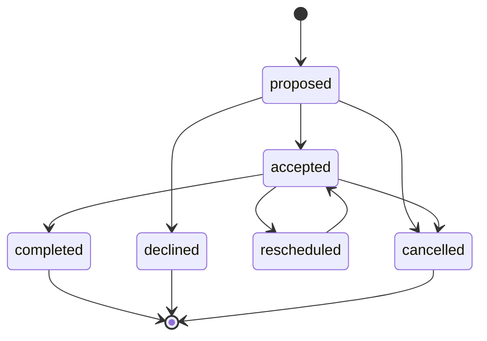

# TutorMatch A.I. — Screen Map & User Flows

**Phase:** 1 — Foundations  
**Status:** Draft v0.1  
**Pilot area:** Cabadbaran City, Agusan del Norte  
**Last updated:** 2026-10-27

## 1. Purpose

This document defines the screen inventory, navigation, user flows, and UI states for the TutorMatch A.I. capstone. It is the contract between product decisions and the UI build. No production code should introduce a screen that is not represented here without updating this document first.

## 2. Product rules

- Two roles: **Student** and **Tutor**. The role is chosen at registration and is fixed for the account.
- Matching is **search-first**. The system does not automatically rank or suggest matches before the user searches.
- A request must be **accepted by both sides** before chat unlocks.
- Location is shown at **barangay level only**. Exact coordinates are never public.
- The UI is **mobile-first** and must remain usable on a mid-range Android phone and a slow connection.
- English is the V1 interface language. Copy should be short and easy to localize into Cebuano later.
- V1 messaging is **text chat + session proposals**. Voice notes and simulated calls are deferred unless they are added as clearly labelled demo features.

## 3. Roles and access

| Role | Access |
|---|---|
| Guest | Landing page, login, registration, terms, privacy |
| Student | Onboarding, search for tutors, request sessions, chat after acceptance, profile, settings |
| Tutor | Onboarding, search for students, receive/send requests, chat after acceptance, profile, settings |
| Admin (internal) | Verification queue, reports, seed/reset, analytics. Not part of the public V1 build |

## 4. Navigation map

### 4.1 Student happy path

### 4.2 Tutor happy path

### 4.3 Request and chat states

### 4.4 Session proposal states

## 5. Screen inventory

| ID | Route | Role | Purpose | Primary actions | Key states |
|---|---|---|---|---|---|
| PUB-01 | `/` | Guest | Explain the product and convert | Sign up, log in, watch how it works | Default, video unavailable |
| AUTH-01 | `/register` | Guest | Choose Student or Tutor | Continue | Role unselected, role selected |
| AUTH-02 | `/register/student`, `/register/tutor` | Guest | Create an account | Register, log in | Validation, submitting, error |
| AUTH-03 | `/login` | Guest | Return to the app | Log in, forgot password | Validation, submitting, error |
| AUTH-04 | `/forgot-password` | Guest | Request a reset link (V1.5) | Send reset link | Sent, error |
| ONB-01 | `/onboarding` | Student/Tutor | Complete the matching profile | Save and continue, back, finish | Step invalid, saving, incomplete |
| APP-01 | `/app/search` | Student/Tutor | Start an explicit search | Search, apply filters, clear | Empty, suggestions, recent searches |
| APP-02 | `/app/search/results` | Student/Tutor | Compare ranked matches | Filter, sort, view profile, request, save | Loading, results, no results, error, offline |
| PROF-01 | `/app/profiles/:id` | Student/Tutor | Evaluate a possible match | Request, save, report | Available, already requested, blocked |
| PROF-02 | `/app/profile` | Student/Tutor | Edit own profile | Save section, upload photo, preview | Incomplete, saving, saved, error |
| PROF-03 | `/app/profile/preview` | Student/Tutor | See the public view | Exit preview | Preview mode banner |
| MSG-01 | `/app/messages?tab=requests` | Student/Tutor | Accept or decline requests | Accept, decline, cancel | Empty, pending, accepted, declined, expired |
| MSG-02 | `/app/messages?tab=chats` | Student/Tutor | Browse conversations | Open chat | Empty, unread, no results |
| MSG-03 | `/app/messages/:id` | Student/Tutor | Chat and arrange a session | Send, propose session, report, block | Locked, active, blocked, offline |
| SET-01 | `/app/settings` | Student/Tutor | Manage account and privacy | Save, log out, delete account | Default, saving, confirmation |
| SAFE-01 | modal | Student/Tutor | Report or block a user | Submit report, block | Default, submitted, error |
| SYS-01 | any | All | Handle missing pages and connectivity | Retry, go back | 404, offline, server error |
| ADM-01 | `/admin/verification` | Admin | Review tutor verification (later) | Approve, reject | Pending, approved, rejected |
| ADM-02 | `/admin/reports` | Admin | Review reports (later) | Resolve, dismiss | Open, resolved |

## 6. Screen specifications

### PUB-01 — Landing page

- Current hero identity stays: cream, orange, ink, serif accent.
- Primary CTAs: **Find a Tutor** and **Become a Tutor**.
- Secondary CTA: **Watch How It Works** opens the video modal.
- Future sections: How It Works, For Students, For Tutors, Safety, FAQ.
- The current background video needs a poster/fallback for slow connections.
- Do not add app navigation here. Guests only see public links.

### AUTH-01 — Role selection

- Two large choice cards:
  - **I need a tutor** — “Find someone who fits your subject, schedule, and budget.”
  - **I want to teach** — “Find students who need your subject and availability.”
- Show a confirmation line: “Your role is fixed after registration.”
- CTA disabled until a role is selected.
- Mobile: stacked cards. Desktop: side-by-side cards.

### AUTH-02 — Register

- Fields: full name, email, password, confirm password, terms checkbox.
- Role is displayed as a read-only chip and is not editable here.
- No profile fields in registration. Profile setup happens in onboarding.
- CTA: **Create account**.
- Link: “Already have an account? Log in.”
- Inline validation and a clear error summary.

### AUTH-03 — Login

- Fields: email, password, remember me.
- Actions: **Log in**, **Forgot password?**
- Link: “New to TutorMatch? Create an account.”
- After login: onboarding if incomplete, otherwise search.

### ONB-01 — Onboarding wizard

Seven steps with a progress indicator. Autosave after each step.

1. **Basics** — photo, display name, bio, birthdate (private), status.
2. **Subjects and levels** — what the tutor teaches or the student needs.
3. **Goals and style** — learning goal, teaching/learning style.
4. **Availability** — weekly slots using a 30- or 60-minute grid.
5. **Rate or budget and format** — hourly rate for tutors, budget range for students, online/in-person/both.
6. **Area** — barangay and city; no exact address.
7. **Preview** — see the public profile and finish.

Rules:
- Required fields cannot be skipped.
- Completeness meter updates live.
- A user cannot appear in search results until the minimum profile is complete.
- “Save and exit” is allowed; the user returns to the same step later.

### APP-01 — Search landing

- Student heading: **Find a tutor**.
- Tutor heading: **Find a student**.
- Search input with subject/keyword.
- Quick subject chips: Math, Calculus, Physics, Chemistry, English, Programming.
- Filter summary: format, budget/rate, availability, distance, level, style.
- Recent searches for returning users.
- **No results are shown until the user submits a search.**
- Empty dashboard state explains what to do in one sentence.

### APP-02 — Ranked results

- Result count and sort control: **Best match**, **Nearest**, **Lowest rate**.
- Active filter chips with individual remove buttons.
- Match cards (see section 7).
- Load more or pagination.
- No automatic filter relaxation. If filters are relaxed, show a visible notice and which filters changed.
- Empty state: explain which filter to widen and offer one-tap adjustments.
- Loading: skeleton cards, not a spinner-only screen.
- Offline: keep the last results and show a retry banner.

### PROF-01 — Public profile

- Header: photo, name, verified badge, headline, role.
- Key facts: subjects/levels, rate or budget, format, barangay, approximate distance, response time.
- About/bio.
- Availability grid with overlapping slots highlighted for the viewer.
- Reviews/ratings later.
- Primary action: **Request a session**.
- Secondary: **Save**.
- Safety menu: report, block.
- If a request already exists, replace the CTA with the request status.
- Never show email, birthdate, exact coordinates, or verification documents.

### PROF-02 — Edit profile

- Sectioned form matching onboarding.
- Photo upload with crop/preview and a default avatar fallback.
- Completeness meter with a checklist of missing items.
- “Preview how others see you” action.
- Privacy note beside the area field: “Only your barangay is shown.”
- Save states: idle, saving, saved, error.

### PROF-03 — Preview

- Reuses the public profile component with the owner’s data.
- Persistent banner: “Preview mode — this is how others see you.”
- Exit preview returns to edit profile.

### MSG-01 — Requests

- Tabs: **Requests** and **Chats**.
- Sub-tabs or filters: Incoming, Outgoing, All.
- Request card: avatar, name, subject, preferred schedule, format, intro message, status.
- Actions: Accept, Decline, Cancel (outgoing only).
- Accepted requests show “Open chat.”
- Declined/expired requests remain visible but read-only for a short period.
- Empty state explains that requests appear here after a search and introduction.

### MSG-02 — Conversations

- Conversation list: avatar, name, last message preview, timestamp, unread badge.
- Locked conversations are not shown here until accepted.
- Search within conversations.
- Empty state: “No conversations yet. Send a request to start one.”

### MSG-03 — Chat

- Header: avatar, name, verified badge, link to profile, safety menu.
- Locked banner if the request is not accepted; composer disabled.
- System messages for request accepted, session proposed, session accepted, session completed.
- Message bubbles: text, timestamps, read state.
- Session proposal card: date/time, duration, format, location or meeting link, note, Accept/Decline/Reschedule.
- Composer: text input, send, attach (later), voice note (later).
- Call button may appear as a **demo** action later; label it clearly.
- Report/block available from the header.
- Offline: queued message state and retry.

### SET-01 — Settings

- Account: name, email, password, log out, delete account.
- Privacy: show barangay, availability visibility, who can send requests.
- Notifications: in-app toggles; email later.
- Safety: blocked users, reports.
- Destructive actions require confirmation.

### SAFE-01 — Report or block

- Reason picker: harassment, spam, impersonation, inappropriate content, no-show, other.
- Optional details.
- Toggle: also block this user.
- Confirmation screen with what happens next.
- Reports are private from the reported user.

## 7. Match card anatomy

The match card is the most important UI component. It should show:

1. Avatar, name, verified badge.
2. Subjects and levels.
3. Rate or budget, format.
4. Barangay and approximate distance.
5. Match score ring and band.
6. Top three reasons.
7. Mini availability grid with overlapping slots highlighted.
8. Primary action: **View profile** or **Request**.
9. Secondary action: **Save**.
10. Warning chip if something is close to a limit, such as “₱50 above budget.”

Score bands:

| Band | Score | UI label |
|---|---|---|
| Excellent | 85–100 | Excellent fit |
| Good | 70–84 | Good fit |
| Fair | 50–69 | Fair fit |
| Low | below 50 | Not shown by default |

Scores are similarity scores, not probabilities. Never label them as “chance of success.”

## 8. Responsive behavior

| Breakpoint | Layout |
|---|---|
| Mobile 360–767 | Bottom nav, one-column cards, filter bottom sheet, sticky primary CTA, full-screen chat |
| Tablet 768–1023 | Two-column results where space allows, collapsible filter panel, sidebar optional |
| Desktop 1024+ | Left sidebar, filter rail + results grid, split profile/chat views |

Mobile bottom navigation:

- **Search**
- **Messages** (with unread badge)
- **Profile**

Tutor and student use the same shell; labels and search defaults change by role.

## 9. State matrix

| State | Where | Required UI behavior |
|---|---|---|
| Loading | Search, profile, messages | Skeleton placeholders; keep layout stable |
| Empty | Search, requests, chats, saved | Explain why it is empty and give one clear next action |
| No results | Search results | Show which filters were restrictive and offer one-tap widening |
| Error | All data screens | Plain-language message, retry button, support path |
| Offline | All app screens | Keep cached content, show offline banner, queue safe actions |
| Unauthorized | App routes | Redirect to login with return path |
| Incomplete profile | Search, requests | Prompt to finish onboarding; hide from results |
| Chat locked | Chat | Explain that acceptance unlocks chat; disable composer |
| Request expired | Requests, chat | Show expired state and allow a new request |
| Blocked | Profile, chat | Hide contact actions and explain the block |
| Rate limited | Requests, messages | Explain the limit and when to try again |

## 10. Component inventory

**Layout**
- AppShell, Sidebar, BottomNav, Topbar, PageHeader, Section, Container

**Inputs**
- Button, IconButton, Input, Textarea, Select, MultiSelect, Chip, Checkbox, Radio, Switch, Slider, TimeSlotPicker, DatePicker

**Display**
- Card, MatchCard, ProfileHeader, Stat, Badge, ScoreRing, ReasonChip, Avatar, AvatarGroup, Rating, ProgressBar, CompletenessMeter

**Matching**
- FilterPanel, FilterSheet, ActiveFilterChip, AvailabilityGrid, MatchBreakdown, SortControl

**Feedback**
- Modal, Drawer, Toast, Tooltip, Skeleton, EmptyState, ErrorState, OfflineBanner, ConfirmDialog

**Messaging**
- RequestCard, RequestStatus, ConversationListItem, MessageBubble, SystemMessage, MessageComposer, SessionProposalCard, UnreadBadge

**Safety**
- ReportDialog, BlockDialog, SafetyMenu, VerifiedBadge

## 11. Copy and tone

Use plain, warm, direct language. Avoid agency language and avoid overclaiming “AI.”

Preferred terms:
- **Find a tutor** / **Find a student**
- **Match** and **fit**, not “AI score”
- **Request a session**, not “Hire”
- **Session**, not “class”
- **Why this match**
- **Within your budget**
- **Free when you are**
- **Chat unlocks when your request is accepted**
- **Complete your profile to appear in more searches**

Examples:
- “Find the tutor who fits how you learn.”
- “Search by subject, schedule, budget, and area.”
- “No exact matches yet. Try online sessions or a wider area.”
- “This tutor is new. Be one of their first students.”
- “Preview mode — this is how others see you.”

## 12. Privacy and safety

**Public profile**
Name, photo, bio, subjects/levels, format, rate or budget, barangay, approximate distance, availability, verified badge, response time, reviews.

**Private**
Email address, birthdate, exact coordinates, password hash, verification documents, reports, block list.

**Rules**
- Show barangay and rounded distance only.
- Never expose exact coordinates or a map pin.
- Chat is visible only to the two participants.
- Do not show email or phone numbers in public profiles.
- Minors require parental consent and stricter safety handling.
- Report and block must be reachable from every profile and chat.
- Verification is manual in V1; show a verified badge only after review.

## 13. Open decisions

1. Frontend stack: React/Vite or vanilla JS modules?
2. Backend stack: Node/Express + PostgreSQL or Supabase?
3. Launch niche: recommended senior high STEM + college math/science.
4. Cebuano localization: V1.5 or later?
5. Voice notes and simulated calls: include as demo features or defer?
6. Payments: keep off-platform in V1 or integrate GCash/Maya later?
7. Defense date and weekly build cadence.
