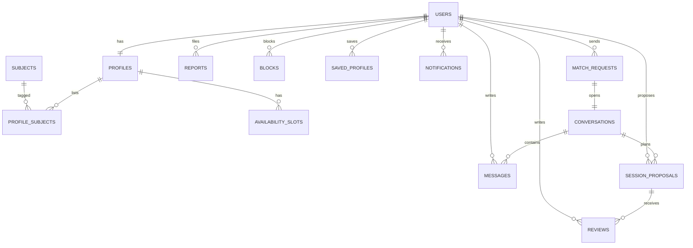

# TutorMatch A.I. — Data Model

**Phase:** 1 — Foundations  
**Status:** Draft v0.1  
**Database target:** PostgreSQL (Supabase or managed Postgres)  
**Last updated:** 2026-10-27

## 1. Purpose

This document defines the entities, relationships, constraints, privacy rules, and matching inputs for TutorMatch A.I. It is the source of truth for the API contract and the future database schema.

## 2. Entity relationship diagram



## 3. Tables

API responses join `users.name`, `users.email`, and `users.role` onto profile records. The `profiles` table stores profile-specific fields only.

### 3.1 `users`

| Column | Type | Notes |
|---|---|---|
| `id` | uuid | Primary key |
| `role` | enum | `student` or `tutor`; immutable after registration |
| `name` | text | Display name |
| `email` | citext | Unique, lowercase, private |
| `password_hash` | text | bcrypt or argon2; never returned by the API |
| `email_verified_at` | timestamptz | Null until verified |
| `status` | enum | `active`, `suspended`, `deleted` |
| `created_at` | timestamptz | Default now |
| `updated_at` | timestamptz | Default now |

### 3.2 `profiles`

| Column | Type | Notes |
|---|---|---|
| `id` | uuid | Primary key |
| `user_id` | uuid | Unique FK to `users` |
| `photo_url` | text | Nullable; default avatar in the UI |
| `bio` | text | Short introduction |
| `birthdate` | date | Private; used for age/safety rules only |
| `headline` | text | Short role summary |
| `status` | enum | `active`, `away`, `accepting`, `not_accepting` |
| `format` | enum | `online`, `in_person`, `both` |
| `area_barangay` | text | Public |
| `area_city` | text | Default `Cabadbaran City` |
| `coarse_geohash` | text | Private; approximate area only |
| `rate_centavos` | integer | Tutor hourly rate; null for students |
| `budget_min_centavos` | integer | Student minimum budget; null for tutors |
| `budget_max_centavos` | integer | Student maximum budget; null for tutors |
| `currency` | char(3) | Default `PHP` |
| `style_tags` | text[] | Teaching or learning style tags |
| `goal_tags` | text[] | Learning or teaching goals |
| `completeness` | smallint | 0–100, derived |
| `verified_at` | timestamptz | Null unless manually verified |
| `response_time_mins` | integer | Derived from recent activity |
| `last_active_at` | timestamptz | Used for freshness, not ranking alone |
| `created_at` | timestamptz | Default now |
| `updated_at` | timestamptz | Default now |

### 3.3 `subjects`

| Column | Type | Notes |
|---|---|---|
| `id` | text | Primary key, e.g. `sub_calculus` |
| `name` | text | e.g. `Calculus` |
| `category` | text | e.g. `Mathematics` |

### 3.4 `profile_subjects`

| Column | Type | Notes |
|---|---|---|
| `id` | uuid | Primary key |
| `profile_id` | uuid | FK to `profiles.id` |
| `subject_id` | text | FK to `subjects.id` |
| `level` | enum | `elementary`, `high_school`, `senior_high`, `college`, `adult` |
| `kind` | enum | `teach` for tutors, `need` for students |

Unique constraint: `(profile_id, subject_id, kind, level)`.

### 3.5 `availability_slots`

| Column | Type | Notes |
|---|---|---|
| `id` | uuid | Primary key |
| `profile_id` | uuid | FK to `profiles.id` |
| `day_of_week` | smallint | 1 = Monday, 7 = Sunday |
| `start_time` | time | Local time |
| `end_time` | time | Local time |
| `timezone` | text | Default `Asia/Manila` |

Unique constraint: `(profile_id, day_of_week, start_time, end_time)`. Check `start_time < end_time`.

The API maps `day_of_week` to `mon`–`sun`; the database stores 1–7, with 1 = Monday.

### 3.6 `match_requests`

| Column | Type | Notes |
|---|---|---|
| `id` | uuid | Primary key |
| `from_user_id` | uuid | FK to `users` |
| `to_user_id` | uuid | FK to `users` |
| `subject_id` | text | FK to `subjects` |
| `message` | text | Short introduction; max 500 characters |
| `preferred_slots` | jsonb | Array of `{ day, start, end }` |
| `format` | enum | `online`, `in_person`, `both` |
| `status` | enum | `pending`, `accepted`, `declined`, `cancelled`, `expired` |
| `created_at` | timestamptz | Default now |
| `responded_at` | timestamptz | Null while pending |
| `expires_at` | timestamptz | Default now + 7 days |

Constraints:
- `from_user_id <> to_user_id`.
- Roles must be opposite; enforce in the API.
- Only one `pending` request per pair; enforce with a partial unique index.
- Request limit and rate limit are enforced in the API.

### 3.7 `conversations`

| Column | Type | Notes |
|---|---|---|
| `id` | uuid | Primary key |
| `request_id` | uuid | Unique FK to `match_requests` |
| `user_a_id` | uuid | FK to `users` |
| `user_b_id` | uuid | FK to `users` |
| `status` | enum | `locked`, `active`, `blocked`, `archived` |
| `last_message_at` | timestamptz | Null until the first message |
| `created_at` | timestamptz | Default now |

### 3.8 `messages`

| Column | Type | Notes |
|---|---|---|
| `id` | uuid | Primary key |
| `conversation_id` | uuid | FK to `conversations` |
| `sender_id` | uuid | Null for system messages |
| `type` | enum | `text`, `system`, `session_proposal`, `voice`, `call_event` |
| `body` | text | Nullable for non-text messages |
| `media_url` | text | Nullable |
| `metadata` | jsonb | Nullable; session or call data |
| `created_at` | timestamptz | Default now |
| `read_at` | timestamptz | Null until read |

Index: `(conversation_id, created_at)`.

### 3.9 `session_proposals`

| Column | Type | Notes |
|---|---|---|
| `id` | uuid | Primary key |
| `conversation_id` | uuid | FK to `conversations` |
| `proposed_by` | uuid | FK to `users` |
| `starts_at` | timestamptz | Future date/time |
| `duration_mins` | smallint | 30, 60, 90, or 120 |
| `format` | enum | `online`, `in_person`, `both` |
| `location_text` | text | Barangay or meeting link |
| `note` | text | Optional |
| `status` | enum | `proposed`, `accepted`, `declined`, `rescheduled`, `completed`, `cancelled` |
| `created_at` | timestamptz | Default now |
| `responded_at` | timestamptz | Null while proposed |

The API exposes `location_text` as `location`.

### 3.10 `reviews` (V1.5)

| Column | Type | Notes |
|---|---|---|
| `id` | uuid | Primary key |
| `session_id` | uuid | FK to `session_proposals` |
| `reviewer_id` | uuid | FK to `users` |
| `reviewee_id` | uuid | FK to `users` |
| `rating` | smallint | 1–5 |
| `comment` | text | Optional |
| `created_at` | timestamptz | Default now |

Unique constraint: `(session_id, reviewer_id)`. Only completed sessions can be reviewed.

### 3.11 `reports`

| Column | Type | Notes |
|---|---|---|
| `id` | uuid | Primary key |
| `reporter_id` | uuid | FK to `users` |
| `reported_user_id` | uuid | FK to `users` |
| `reason` | enum | `harassment`, `spam`, `impersonation`, `inappropriate`, `no_show`, `other` |
| `details` | text | Optional |
| `conversation_id` | uuid | Nullable FK |
| `status` | enum | `open`, `resolved`, `dismissed` |
| `created_at` | timestamptz | Default now |
| `reviewed_at` | timestamptz | Nullable |

### 3.12 `blocks`

| Column | Type | Notes |
|---|---|---|
| `blocker_id` | uuid | FK to `users` |
| `blocked_id` | uuid | FK to `users` |
| `created_at` | timestamptz | Default now |

Primary key: `(blocker_id, blocked_id)`. A user cannot block themselves.

### 3.13 `saved_profiles` (V1.5)

| Column | Type | Notes |
|---|---|---|
| `user_id` | uuid | FK to `users` |
| `profile_id` | uuid | FK to `profiles.id` |
| `created_at` | timestamptz | Default now |

Primary key: `(user_id, profile_id)`. A user cannot save themselves.

### 3.14 `notifications`

| Column | Type | Notes |
|---|---|---|
| `id` | uuid | Primary key |
| `user_id` | uuid | FK to `users` |
| `type` | text | `request_received`, `request_accepted`, `message_received`, `session_proposed`, `session_accepted` |
| `payload` | jsonb | IDs and display data |
| `read_at` | timestamptz | Null until read |
| `created_at` | timestamptz | Default now |

Index: `(user_id, read_at)`.

### 3.15 `analytics_events`

| Column | Type | Notes |
|---|---|---|
| `id` | uuid | Primary key |
| `user_id` | uuid | Nullable FK |
| `name` | text | Event name |
| `payload` | jsonb | Non-sensitive metadata |
| `created_at` | timestamptz | Default now |

Never store emails, passwords, message bodies, or exact locations in this table.

### 3.16 `verification_requests` (V1.5)

| Column | Type | Notes |
|---|---|---|
| `id` | uuid | Primary key |
| `user_id` | uuid | FK to `users` |
| `document_type` | text | School ID, government ID, or credential |
| `document_url` | text | Private storage URL |
| `status` | enum | `pending`, `approved`, `rejected` |
| `reviewed_by` | uuid | Nullable admin user |
| `created_at` | timestamptz | Default now |
| `reviewed_at` | timestamptz | Nullable |

## 4. Indexes

- `users.email` unique.
- `profiles.user_id` unique.
- `profile_subjects(subject_id, level)` for candidate generation.
- `profile_subjects(profile_id)` for profile loading.
- `availability_slots(profile_id, day_of_week)` for overlap checks.
- `match_requests(to_user_id, status)` and `(from_user_id, status)`.
- Partial unique index on pending requests for `(from_user_id, to_user_id)`.
- `conversations(request_id)` unique.
- `messages(conversation_id, created_at)`.
- `session_proposals(conversation_id, starts_at)`.
- `notifications(user_id, read_at)`.
- `analytics_events(name, created_at)`.
- `profiles(area_barangay)` for coarse area queries.

## 5. Privacy matrix

| Field | Public profile | Matched users | Private |
|---|---|---|---|
| Name | Yes | Yes | — |
| Photo | Yes | Yes | — |
| Bio | Yes | Yes | — |
| Subjects and levels | Yes | Yes | — |
| Format | Yes | Yes | — |
| Rate or budget | Yes | Yes | — |
| Barangay | Yes | Yes | — |
| Approximate distance | Yes | Yes | — |
| Availability | Yes | Yes | — |
| Verified badge | Yes | Yes | — |
| Response time | Yes | Yes | — |
| Reviews | Yes | Yes | — |
| Email | No | No | Yes |
| Birthdate | No | No | Yes |
| Exact coordinates | No | No | Yes |
| Password hash | No | No | Yes |
| Verification documents | No | No | Yes |
| Reports and blocks | No | No | Yes |
| Chat messages | No | Participants only | — |

Location rule: store a coarse geohash or barangay centroid, compute distance on the server, and return metres rounded to the nearest 100. Never return a map pin.

## 6. Profile completeness

Completeness is derived from the profile fields and shown as a percentage.

| Section | Weight | Required for search |
|---|---:|---|
| Basics: headline, bio, photo | 15 | Bio required; photo optional |
| Subjects and levels | 20 | Yes, at least one |
| Goals and style | 15 | Recommended |
| Availability | 20 | Yes, at least one slot |
| Rate or budget and format | 15 | Yes |
| Area: barangay | 10 | Yes |
| Verification | 5 | Optional |

Verification is optional; a complete but unverified profile can reach 95%.

Minimum to appear in search results:

- At least one subject with a level.
- At least one availability slot.
- A rate (tutor) or budget range (student).
- A format.
- A barangay.
- A short bio.

Profiles below the minimum are hidden from search and show a checklist in the profile editor. The completeness percentage is a UI aid, not a ranking feature.

## 7. Matching inputs

### 7.1 Hard filters

- Opposite role.
- Format compatibility.
- Budget/rate covers the other side when the user marks it firm.
- Maximum distance for in-person or both.
- Minimum availability overlap.
- Blocked users excluded.
- Incomplete profiles excluded.

### 7.2 Soft features and suggested weights

| Feature | Encoding | Distance | Starting weight |
|---|---|---|---:|
| Subject and level | Multi-hot subjects + level rank | Weighted Jaccard + level gap | 35% |
| Availability | Weekly slots | Jaccard overlap | 20% |
| Budget/rate | Integer centavos | Normalized absolute difference | 15% |
| Distance | Barangay centroid / coarse geohash | Haversine, normalized | 15% |
| Style and goal | Multi-select tags | Jaccard | 15% |

Weights are a starting point, not a final truth. Document them, evaluate them, and tune only with evidence.

### 7.3 Score

```
distance = Σ (weight_i × normalized_feature_distance_i)
score = round(100 × (1 - distance))
```

Pair score:

- Compute student-to-tutor fit and tutor-to-student fit where data allows.
- Final score is a weighted average, or the minimum of the two for stricter matching.
- A one-sided score must be labelled as such in the API response.

### 7.4 Explanation

- Compute each feature's contribution to the final distance.
- Convert the strongest positive contributions into at most three plain-language reasons.
- Show warnings for soft conflicts, such as a rate slightly above budget.
- Never fabricate a reason for missing data.

### 7.5 Cold start

- New students can search with a partial profile but cannot send requests until the minimum is complete.
- New tutors are hidden until the minimum is complete; after that, give a small exploration boost so they are not buried.
- If fewer than three results pass the hard filters, relax style and goal first, then distance. Never silently relax budget or format.
- If no results remain, return an empty result with suggestions instead of low-quality matches.

### 7.6 Evaluation

For the capstone defense, compare KNN ranking against:

- A subject-only baseline.
- A random baseline.
- A popularity baseline.

Measure precision@k with a small hand-labelled set, plus real interaction metrics such as request acceptance rate and session completion rate. Log search and request events from day one.

## 8. Seed data plan

- 20–30 tutor profiles and 10–15 student profiles.
- Fictional names, real Cabadbaran barangays, no real contact information.
- Mix of online-only, in-person, and both.
- Mix of complete and incomplete profiles to demonstrate cold start.
- Multiple subjects: Math, Calculus, Physics, Chemistry, English, Programming, Biology, Filipino.
- Sample pending requests, one accepted request, one conversation, and one session proposal so every screen has data.
- A reset-demo script that restores the seed data without touching production data.

## 9. Open data decisions

1. Use Supabase Auth or custom auth with Node/Express?
2. Store photos in Supabase Storage, Cloudinary, or local disk for the demo?
3. Add Cebuano labels as a translation layer or duplicate content?
4. Add reviews in V1 or V1.5?
5. Add GCash/Maya payments later, or keep payments off-platform?
